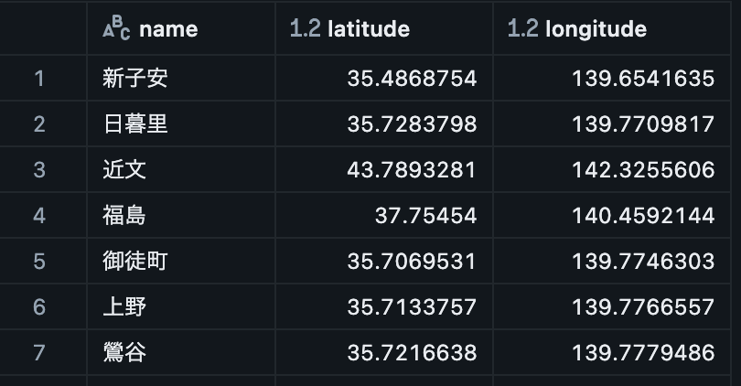
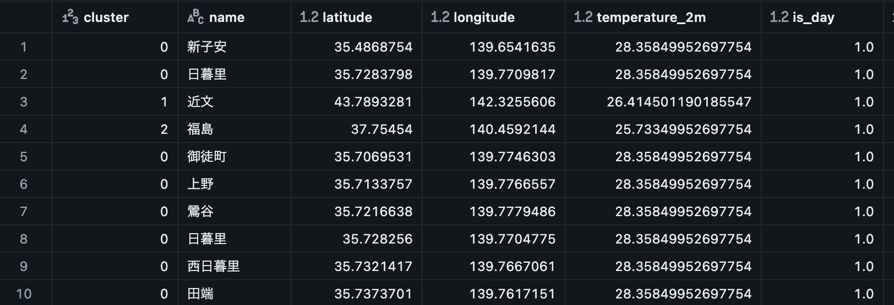
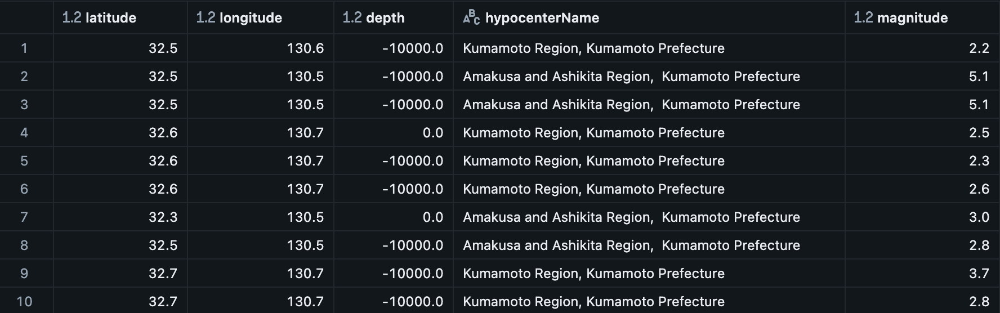
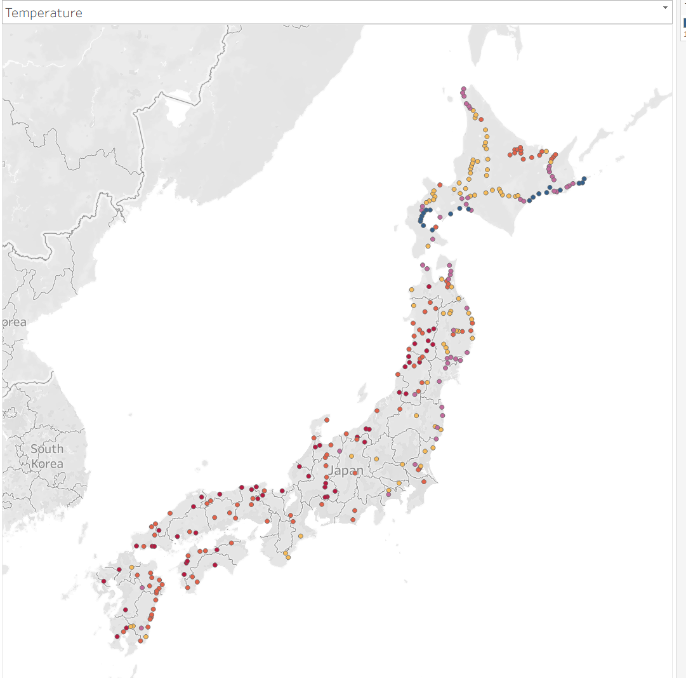
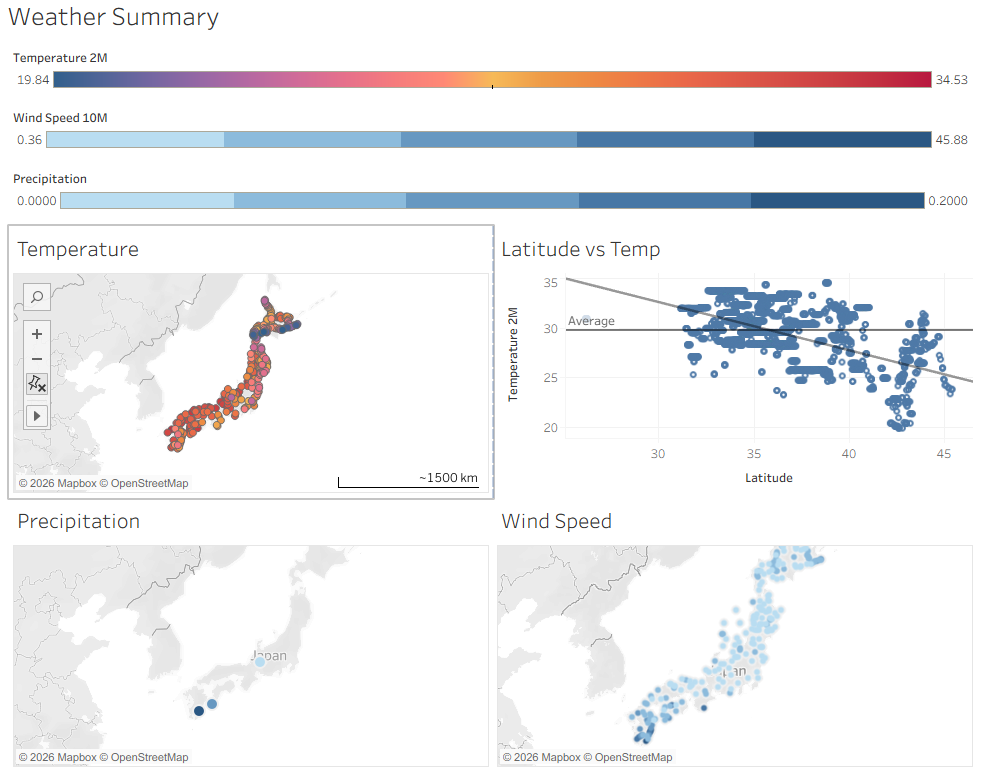

## Databricks Data flow
The following shows images of the Databricks pipeline.

The data flow of the pipeline can be seen in the figure below.


The pipeline begins by parsing the parquet file for a list of train stations. This list is created from an OpenStreetMap (OSM) dataset, and uploaded to a volume. This parses the dataset, and creates a stations table.



Once parsed, the stations are grouped using DBSCAN to find clusters of train stations. This helps limit the API calls to OpenMeteo weather API, by only grabbing weather for a selected representative within that cluster. For each of the clusters, weather such as temperature, wind speed, and precipitation are obtained, and reassigned to each station within the cluster.



Separately, earthquake events are pulled from the JMA quake API by parsing JSON files on the website, once parsed, these files are parsed into a earthquake table.



Finally, once all initial tables are created, silver and gold tables are created from the base tables by filtering out troublesome rows, nulls, etc.

The dashboards were created using tableau and imported into Databricks and GCP.

Temperature:



Weather Summary:



## Databricks Deployment Steps

1. Databricks DABs are used to deploy the pipeline, a YAML file is created to deploy this pipeline [dab](databricks.yaml)
2. Run the SQL commands to create catalog, schema, volumes [create-env.sql](create-env.sql)
3. Due to newer OSM API requirements, a parquet file  should be uploaded to a volume, then referenced in 
4. Deployment steps as follows:
   ```bash
   databricks bundle validate
   ```
   ```bash
   databricks bundle deploy
   ```
