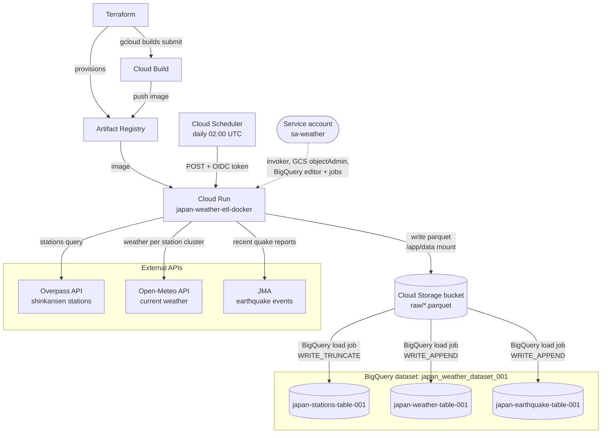
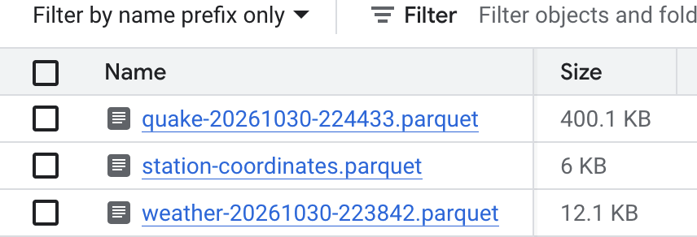
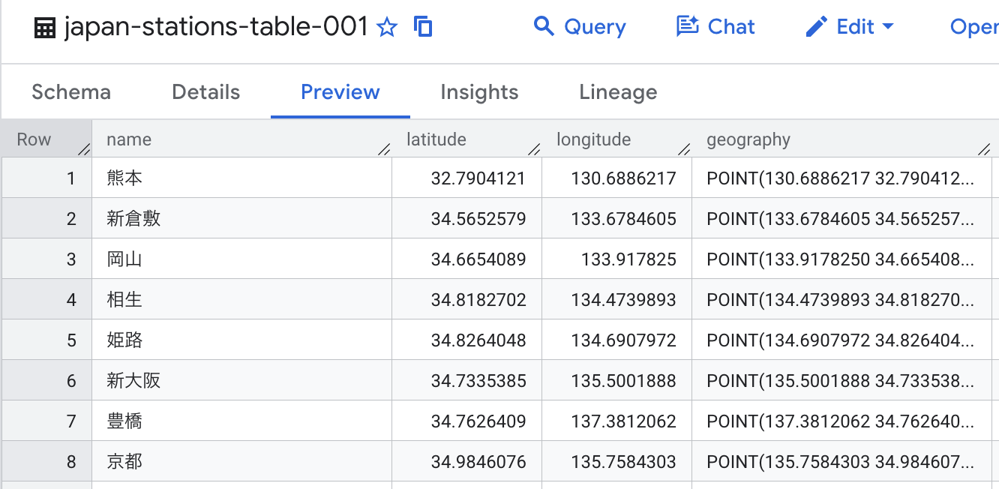

## GCP Data Flow



## Screenshots

The cloud run function when called creates parquet files in GCS, as well as loads the data directly into BigQuery upon execution. These parquet files can be seen below:



This data is then loaded into BigQuery datasets created by terraform. First the 



## GCP Deployment Steps

1. Enable the following Google Cloud APIs:
- Artifact Registry (artifactregistry.googleapis.com)
- Cloud Run (run.googleapis.com)

2. Authenticate to GCP for Terraform:

```bash
gcloud auth login
gcloud auth application-default login
```

3. Test the Docker image locally (optional):

```bash
docker build -t japan-weather-etl ./gcp
docker run --rm -it japan-weather-etl
```

4. Configure `gcp/terraform/terraform.tfvars` with the following values:

```
project = ""
region = ""
location = ""
overpass_referer = ""
overpass_user_agent = ""
```

5. Deploy with Terraform. 
```bash
cd gcp/terraform
terraform init
terraform apply
```

6. Terraform creates the Artifact Registry repository, builds and pushes the image with Cloud Build, and provisions Cloud Run and its supporting resources:

7. Trigger the cloud function